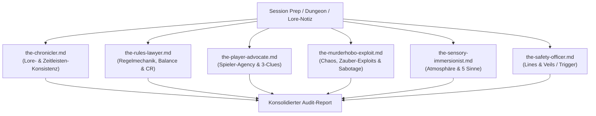

# RG Worldbuilding

[](https://github.com/Lukas-Rdt/rg-worldbuilding-plugin/actions/workflows/ci.yml)

> [!IMPORTANT]
> **Private Distribution & Installation**
> Dieses Repository ist ein privater Fork für das **RG Worldbuilding Plugin** (D&D / TTRPG), optimiert für bestehende **Obsidian Vaults**.
> 
> **Option 1: Direct Private Git Import (Claude Code)**
> ```text
> /plugin marketplace add Lukas-Rdt/rg-worldbuilding-plugin
> /plugin install rg-worldbuilding
> ```
> 
> **Option 2: Local Checkout Install**
> 1. Repository klonen:
>    ```bash
>    git clone https://github.com/Lukas-Rdt/rg-worldbuilding-plugin.git
>    ```
> 2. Im jeweiligen Agenten installieren:
>    ```text
>    /plugin install /path/to/rg-worldbuilding-plugin
>    ```
> 
> Für weitere Agenten (OpenCode, Antigravity, Cursor, etc.), siehe [Installation](#install).

---

# RG Worldbuilding

AI skills that compound tabletop worldbuilding and campaign prep.

## Philosophie: Compound Worldbuilding

> *"Jede Einheit Worldbuilding- und Vorbereitungsarbeit muss nachfolgende Einheiten leichter machen — nicht schwerer."*

Klassische Kampagnenvorbereitung leidet unter wachsenden **Lore- und Prep-Schulden (Lore Debt)**:
Spontane Improvisationen, unstrukturierte Notizen und widersprüchliche NSC-Entscheidungen häufen sich an, bis Spielleiter (DMs) vor jeder Session stundenlang nach alten Notizen suchen oder unbemerkt Kontinuitätsbrüche erzeugen.

**Das RG-Worldbuilding-Plugin invertiert dies:**
1. **Fundierte Vorbereitung vor der Sitzung:** Strukturierte Vorbereitung nach bewährten Frameworks (z. B. Sly Flourish's *Lazy DM* und Justin Alexander's *Node-Based Design*).
2. **Multi-Agent Review:** Automatische Plausibilitäts-, Balance- und Plothole-Checks durch 6 spezialisierte Agenten-Personas vor dem Spielabend.
3. **At-the-Table Usability:** Automatische Destillation von Fließtext in bullet-point-basierte, spielfertige Schnellreferenzen mit sensorischen Details und hervorgehobenen DCs.
4. **Post-Session Compounding:** Gespielte Ereignisse, getroffene Entscheidungen und Retcons werden nach jeder Sitzung erfasst und kanonisiert (`WORLD_CANON.md`), sodass nachfolgende Vorbereitungen direkt darauf aufbauen.

---

## Obsidian-First & No-Git Integration

Das Plugin arbeitet direkt in einem **bestehenden Obsidian Vault**:
* **Schutz bestehender Daten (Non-Destructive):** Kein starres Ordnerlayout aufgezwungen; das Plugin scannt und adaptiert vorhandene Strukturen (`01 Kampagne/`, `NSCs/`, `Orte/`, etc.).
* **Kanon-Erkennung & Verlinkung:** Erkennt existierende Lore und nutzt standardmäßig Obsidian-`[[WikiLinks]]` und Dataview-Frontmatter.
* **No-Branching / No-Git:** Da in Obsidian automatische Backup- oder Git-Plugins laufen, entfallen alle Git-, Branch-, Worktree- und PR-Mechaniken. Änderungen geschehen direkt in Zieldateien oder mit Status-Frontmatter (`status: draft` vs. `status: ready`).

---

## Workflow-Zyklus

Der Kernzyklus verbindet Ideenfindung, Vorbereitung, Plausibilitätsprüfung und Kanonisierung:

| Skill | Zweck & Schwerpunkt |
|-------|----------------------|
| [`/rg-init`](skills/rg-init/SKILL.md) | **Onboarding:** Scannt das bestehende Vault, führt Konfigurations-Interview, schreibt `.rg-worldbuilding/config.local.yaml`. |
| [`/rg-premise`](skills/rg-premise/SKILL.md) | Erstellt & pflegt `CAMPAIGN_FRAMEWORK.md`: Tonalität, Setting, Pillars, Safety Tools, Hausregeln. |
| [`/rg-spark`](skills/rg-spark/SKILL.md) | Generiert 10+ kreative Ansätze für Quests, Fraktionen, Wendungen oder Monster; filtert Klischees heraus. |
| [`/rg-flesh-out`](skills/rg-flesh-out/SKILL.md) | Interaktives Interview zur detaillierten Ausarbeitung eines Elements (NSC, Artefakt, Kult, Dungeon). |
| [`/rg-prep-plan`](skills/rg-prep-plan/SKILL.md) | Strukturierte Session-Vorbereitung (Lazy DM / Node-Based): Starker Auftakt, Szenen, 10 Geheimnisse & Hinweise, Schauplätze. |
| [`/rg-craft`](skills/rg-craft/SKILL.md) | Systematische Erstellung & Verlinkung der vorbereiteten Dokumente, Szenen und Encounter direkt im Vault (ohne Git). |
| [`/rg-distill`](skills/rg-distill/SKILL.md) | **At-the-Table Usability:** Kürzt Fließtext auf Stichpunkte, hebt Schlüsselwörter hervor (**DC 14 Investigation**), extrahiert Sinneswahrnehmungen. |
| [`/rg-lore-audit`](skills/rg-lore-audit/SKILL.md) | **Multi-Agent Review:** 6 Personas prüfen Entwürfe auf Kanon, 5e-Regeln, Spieler-Agency, Plotholes und Sicherheit. |
| [`/rg-compound-canon`](skills/rg-compound-canon/SKILL.md) | **Post-Session Loop:** Erfasst Session-Ergebnisse, aktualisiert NSC-Zustände, passt Uhren an und schreibt Fakten in `WORLD_CANON.md`. |

---

## Multi-Agent Lore-Audit

Das Herzstück der Qualitätssicherung (`/rg-lore-audit`): 6 spezialisierte TTRPG-Personas prüfen Vorbereitungen vor dem Spielabend:



1. **`the-chronicler`**: Prüft Konsistenz mit `WORLD_CANON.md`, Zeitleisten und etablierten NSC-Beziehungen.
2. **`the-rules-lawyer`**: Validiert Regeln, Action Economy, DCs und CR-Balancing.
3. **`the-player-advocate`**: Prüft Spieler-Freiheit (Agency), Three-Clue Rule und verhindert Frust & Railroading.
4. **`the-murderhobo-exploit`**: Simuliert Chaos-Spieler und Zauber-Exploits (*Pass without Trace*, *Fly*, Angriffe auf Questgeber).
5. **`the-sensory-immersionist`**: Prüft Vorlesetexte (Boxed Text) auf max. 3–4 Sätze und Einbindung mehrerer Sinneskanäle.
6. **`the-safety-officer`**: Gleicht Inhalte mit den festgelegten Lines & Veils der Kampagne ab.

---

## TTRPG-Spezialskills

* [`/rg-statblock`](skills/rg-statblock/SKILL.md): Mathematisch korrekte D&D 5e / PF2e Monster- und NSC-Werteblöcke (CR-Berechnung, Trefferwürfel, Zauberplätze, Obsidian-5e-Syntax).
* [`/rg-rolltable`](skills/rg-rolltable/SKILL.md): Stimmungsvolle, ausgewogene Zufallstabellen (d6, d8, d10, d20, d100).
* [`/rg-handout`](skills/rg-handout/SKILL.md): Diegetische In-Game-Materialien (Briefe, Tagebucheinträge, Steckbriefe, alte Kartenlegenden).
* [`/rg-map-spec`](skills/rg-map-spec/SKILL.md): Strukturierte Raumkataloge für Dungeons und Schauplätze (Grid, Beleuchtung, Fallen, Taktik, Map-Prompts).

---

## Install

### Claude Code

```text
/plugin marketplace add Lukas-Rdt/rg-worldbuilding-plugin
/plugin install rg-worldbuilding
```

### Cursor

Im Cursor Agent Chat:

```text
/add-plugin rg-worldbuilding
```

### Codex CLI

```bash
codex plugin marketplace add Lukas-Rdt/rg-worldbuilding-plugin
codex plugin add rg-worldbuilding@rg-worldbuilding-plugin
```

### Antigravity CLI (`agy`)

```bash
agy plugin install https://github.com/Lukas-Rdt/rg-worldbuilding-plugin
```

### OpenCode

In `opencode.json`:

```json
{
  "plugin": ["rg-worldbuilding@git+https://github.com/Lukas-Rdt/rg-worldbuilding-plugin.git"]
}
```

---

## Entwicklung & Validierung

```bash
bun install
bun test                  # Test-Suite ausführen
bun run release:validate  # Release- und Metadaten-Konsistenz prüfen
```

## Lizenz

[MIT](LICENSE)
