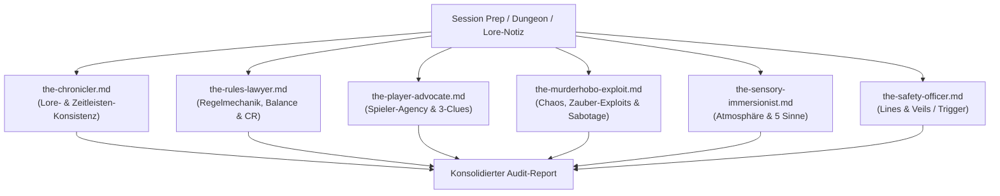

# Spezifikation & Transformationsplan: RG-Worldbuilding-Plugin (DnD / TTRPG)

> **Zweck dieses Dokuments:**  
> Dieses Dokument dient als verbindlicher Master-Leitfaden für eine KI-Entwicklungsinstanz, die nach dem Klonen dieses Repositories die vollständige Transformation vom Software-fokussierten `rg-engineering-plugin` zum kreativen **`rg-worldbuilding-plugin`** vornimmt.  
> Es beschreibt die Ziel-Architektur, alle Skill-Anpassungen, die Multi-Agenten-Personas sowie die nahtlose Integration in ein **bestehendes Obsidian Vault** einer laufenden D&D-Kampagne.

---

## 1. Vision & Leitprinzipien

### 1.1 Leitphilosophie: Compound Worldbuilding
> *"Jede Einheit Worldbuilding- und Vorbereitungsarbeit muss nachfolgende Einheiten leichter machen — nicht schwerer."*

Klassische Kampagnenvorbereitung leidet unter wachsenden **Lore- und Prep-Schulden (Lore Debt)**:
Spontane Improvisationen, unstrukturierte Notizen und widersprüchliche NSC-Entscheidungen häufen sich an, bis Spielleiter (DMs) vor jeder Session stundenlang nach alten Notizen suchen oder unbemerkt Kontinuitätsbrüche erzeugen.

**Das RG-Worldbuilding-Plugin invertiert dies:**
1. **Fundierte Vorbereitung vor der Sitzung:** Strukturierte Vorbereitung nach bewährten Frameworks (z. B. Sly Flourish's *Lazy DM* und Justin Alexander's *Node-Based Design*).
2. **Multi-Agent Review:** Automatische Plausibilitäts-, Balance- und Plothole-Checks durch spezialisierte Agenten-Personas vor dem Spielabend.
3. **At-the-Table Usability:** Automatische Destillation von Fließtext in bullet-point-basierte, spielfertige Schnellreferenzen mit sensorischen Details.
4. **Post-Session Compounding:** Gespielte Ereignisse, getroffene Entscheidungen und Retcons werden nach jeder Sitzung erfasst und kanonisiert, sodass nachfolgende Vorbereitungen direkt darauf aufbauen.

### 1.2 Wichtigste Konventionen
* **Plugin-Name:** `rg-worldbuilding` (Display Name: *RG Worldbuilding*).
* **Skill-Präfix:** Alle Skills behalten ausnahmslos das Präfix **`rg-`** (z. B. `rg-flesh-out`, `rg-prep-plan`, `rg-lore-audit`, `rg-compound-canon`).
* **Ziel-Ökosystem:** Markdown-Dateien mit YAML-Frontmatter, primär optimiert für ein **bestehendes Obsidian Vault** (inkl. `[[WikiLinks]]`, Dataview-Kompatibilität und Alias-Support).
* **No-Branching / No-Git Paradigma:** Da im Vault meist automatische Backup-/Git-Plugins (z. B. *Obsidian Git*) laufen, entfallen alle Git-, Branch-, Worktree- und PR-Mechaniken aus sämtlichen Skills vollständig!

---

## 2. Obsidian-First Integration (Bestehendes D&D Vault)

Das Plugin wird direkt auf ein bereits existierendes Obsidian-Vault angewendet, in dem der wesentliche Teil einer aktiven D&D-Kampagne liegt. Die Skills müssen darauf Rücksicht nehmen:

### 2.1 Schutz & Respekt bestehender Daten (Non-Destructive)
1. **Kein Überschreiben gewachsener Strukturen:** Das Plugin erzwingt kein starres Ordnerlayout. Es passt sich dynamisch an bestehende Ordner an (z. B. `01 Kampagne/`, `NSCs/`, `Orte/`, `Sessions/` etc.).
2. **Kanon-Erkennung:** Vor dem Erstellen neuer Entitäten prüfen die Skills (mittels Vault-Scan), ob bereits Notizen zu einem Thema existieren, und verlinken diese bevorzugt via `[[Name|Alias]]`.
3. **YAML-Frontmatter-Integrität:** Bestehende Frontmatter-Eigenschaften in Obsidian-Notizen (Tags, Typen, Aliases, Dataview-Felder) dürfen bei Updates nicht gelöscht, sondern nur ergänzt oder gezielt aktualisiert werden.

---

### 2.2 Interaktives Onboarding & Konfiguration (`rg-init` & `config.local.yaml`)

Da ein bestehendes Vault die Konfigurationsdatei noch nicht besitzt, wird ein dedizierter Setup- und Onboarding-Skill **`rg-init`** implementiert (der auch später zur Neukonfiguration via `rg-configure` aufgerufen werden kann).

#### Ablauf von `/rg-init`:
1. **Automatischer Vault-Scan:**
   * Durchsucht die vorhandene Ordnerstruktur und identifiziert typische Muster (z. B. Ordner für Sessions, NPCs, Orte, Lore, Quests).
   * Ermittelt, ob bereits Vorlagen (Templates), Dataview-Felder oder Statblock-Plugins genutzt werden.
2. **Interaktives Interview (Einzelschritt-Dialoge mit dem DM):**
   * **Regelwerk & Edition:** D&D 5e (2014), D&D 2024, Pathfinder 2e, System-Agnostisch.
   * **Ordner-Mapping:** Bestätigung oder Korrektur der erkannten Pfade (z. B. "Sollen neue NPCs in `02 World/NPCs/` gespeichert werden?").
   * **Formatierungs-Präferenzen:** `[[WikiLinks]]` (Standard für Obsidian) vs. Standard-Markdown-Links; Dataview-kompatible Tags.
   * **Kampagnen-Fokus & Tonalität:** Heroic Fantasy, Grimdark, Mystery; Pillars of Play (z. B. 40% Social, 30% Combat, 30% Exploration).
   * **Sicherheits-Tools (Safety Tools):** Abfrage von Lines & Veils für die Gruppe.
3. **Erstellung der Konfigurationsdatei:**
   Schreibt `.rg-worldbuilding/config.local.yaml` im Vault-Root:
   ```yaml
   campaign:
     name: "Meine DnD Kampagne"
     system: "dnd5e"              # dnd5e, dnd2024, pf2e, system-agnostic
     edition: "2024"
     tone: "Heroic Fantasy with Political Intrigue"
     pillars: "40/30/30"          # Social / Combat / Exploration
   paths:
     sessions: "Sessions"
     npcs: "World/NPCs"
     locations: "World/Locations"
     factions: "World/Factions"
     lore: "World/Lore"
     handouts: "Handouts"
   vault:
     link_style: "wikilinks"      # [[Name|Alias]]
     use_dataview: true
     statblock_format: "obsidian-5e" # obsidian-5e, markdown, json
   ```
4. **Initiales Bootstrapping (Optional auf Wunsch des DMs):**
   * Legt bei Bedarf `CAMPAIGN_FRAMEWORK.md` (Basis-Prämissen) an.
   * Erstellt `WORLD_CANON.md` und indiziert bereits vorhandene Hauptcharaktere und Schauplätze.

---

### 2.3 Radikales Entfernen von Git-, Branching- und PR-Mechaniken

In Software-Plugins steuern Git-Branches, Pull Requests, CI-Checks und Git-Worktrees den Fluss.  
**In Obsidian entfällt dies komplett:** DMs nutzen häufig automatische Commit-Plugins (z. B. *Obsidian Git*), mobile Synchronisation (Obsidian Sync) oder Cloud-Ordner.

**Verbindliche Regeln für alle Skills:**
1. **Keine Git-Befehle im Workflow:** Keine Aufrufe von `git checkout -b`, `git branch`, `git worktree`, `git commit`, `git push` oder `gh pr create`.
2. **Direktes Arbeiten im Vault (In-Place / Drafts):**
   * Änderungen werden direkt an den Zieldateien vorgenommen.
   * Für noch nicht abgeschlossene Entwürfe wird mit Obsidian-Status gearbeitet (z. B. YAML-Frontmatter `status: draft` vs. `status: ready`) oder in einem dedizierten Prep-Ordner vorbereitet.
3. **Ersetzen von `git diff` im Lore-Audit (`rg-lore-audit`):**
   Anstatt Git-Diffs zu prüfen, bestimmt der Audit seinen Prüfbereich über:
   * **Expliziten Pfad:** `/rg-lore-audit Sessions/Session-14.md` oder `/rg-lore-audit World/NPCs/Malakor.md`.
   * **Zuletzt geänderte Notizen:** Scannt nach Dateien mit dem jüngsten Änderungsdatum.
   * **Interaktive Auswahl:** Fragt den DM via Dialog: *"Welche Session oder Lore-Notiz möchtest du prüfen?"*
4. **Vollautonomer Workflow (`lfg` / `rg-autoprep`):**
   Führt den kompletten Worldcraft-Zyklus ohne Git aus:
   *Konzeption -> Szenen- & NSC-Ausarbeitung -> Multi-Agent-Audit -> Einarbeitung der Audit-Punkte -> Distillation zu spielfertigen Notizen.*

---

## 3. Transformations-Inventar: Skills & Tools

### 3.1 Zu entfernende Software- & Git-Skills (Deprecations)
Folgende Skills werden komplett aus dem Repository entfernt:
* `skills/rg-test-browser/` (Entfernen – Browsertests)
* `skills/rg-test-xcode/` (Entfernen – iOS/Xcode)
* `skills/rg-dogfood/` (Entfernen – Automatisiertes QA)
* `skills/rg-worktree/` (Entfernen – Git-Worktrees)
* `skills/rg-commit/` (Entfernen – Git Commits werden durch Obsidian-Auto-Commit-Plugins gehandhabt)
* `skills/rg-commit-push-pr/` (Entfernen – Keine PRs im Vault)

---

### 3.2 Mapping & Refactoring der bestehenden Skills

Alle beibehaltenen Skills behalten das Präfix `rg-`:

| Altes Skill (Engineering) | Neues Skill (Worldbuilding) | Neuer Schwerpunkt & Zweck im TTRPG |
| :--- | :--- | :--- |
| `rg-setup` | **`rg-init`** | **Interaktives Onboarding:** Scannt das bestehende Vault, führt Konfigurations-Interview, schreibt `config.local.yaml`. |
| `rg-configure` | **`rg-configure`** | Aktualisiert oder ergänzt Vault-Pfade, Regelwerk und Format-Einstellungen. |
| `rg-strategy` | **`rg-premise`** | Erstellt & pflegt `CAMPAIGN_FRAMEWORK.md`: Tonalität, Setting-Prämisse, Pillars, Safety Tools, Hausregeln, Fraktionsfronten. |
| `rg-ideate` | **`rg-spark`** | Generiert 10+ kreative Ansätze für Quests, Fraktionen, Wendungen oder Monster; filtert Cliches aus und liefert die 3 stärksten Optionen. |
| `rg-brainstorm` | **`rg-flesh-out`** | Interaktives 1-Frage-Interview zur Ausarbeitung eines Elements (NSC, Artefakt, Kult, Dungeon-Idee) mit Fokus auf Motivation, Schwächen und Geheimnisse. |
| `rg-plan` | **`rg-prep-plan`** | Strukturierte Session-Vorbereitung (Lazy DM / Node-Based): Starker Auftakt, Szenen/Knoten, 10 Geheimnisse & Hinweise, Schauplätze, NSC-Pool. |
| `rg-work` | **`rg-craft`** | Systematische Erstellung & Verlinkung der vorbereiteten Dokumente, Szenen, Statblocks und Encounter direkt im Vault (ohne Git). |
| `rg-simplify-code` | **`rg-distill`** | **At-the-Table Usability:** Kürzt Fließtext-Notizen auf Stichpunkte, hebt Schlüsselwörter hervor (**DC 14 Investigation**), extrahiert Sinneswahrnehmungen. |
| `rg-code-review` | **`rg-lore-audit`** | **Multi-Agent Review:** Spezialisierte Personas prüfen Entwürfe auf Kanon, 5e-Regeln, Spieler-Freiheit (Agency), Railroading und Spieltisch-Chaos. |
| `rg-doc-review` | **`rg-arc-review`** | Prüft größere Kampagnen-Bögen, Dungeon-Ökologien und Modul-Zusammenhänge vor dem Spiel. |
| `rg-compound` | **`rg-compound-canon`** | **Post-Session Loop:** Erfasst Session-Ergebnisse, aktualisiert NSC-Zustände, passt Fraktions-Uhren an und schreibt Fakten in `WORLD_CANON.md`. |
| `rg-compound-refresh` | **`rg-canon-refresh`** | Prüft das gesamte Vault auf veraltete Links, ungelöste Widersprüche und aktualisiert das Begriffs- und NSC-Register. |
| `rg-debug` | **`rg-patch-plothole`** | Untersucht Lore-Widersprüche und erarbeitet elegante, diegetische In-Game-Erklärungen und Retcons. |
| `rg-explain` | **`rg-lore-primer`** | Erstellt zielgerichtete Handouts für Spieler basierend auf deren Charakterwissen (z. B. "Was ein Elf aus Evermeet über Myth Drannor weiß"). |
| `rg-product-pulse` | **`rg-table-pulse`** | Analysiert offene Handlungsfäden, Spielerverhalten und Engagement nach mehreren Sitzungen. |
| `rg-riffrec-feedback-analysis`| **`rg-audio-debrief`** | Verarbeitet Sprachmemos oder rohe Session-Aufnahmen des DMs zu strukturierten Zusammenfassungen. |
| `rg-sweep` | **`rg-thread-sweep`** | Scannt das Vault nach ungelösten Quest-Hooks, vergessenen NSCs und offenen Versprechen. |
| `rg-pov` | **`rg-ruling-pov`** | Liefert fundierte Abwägungen zu Hausregeln, Regelauslegungen (RAW vs. RAI) oder Lore-Entscheidungen. |
| `lfg` | **`lfg`** oder **`rg-autoprep`** | Vollautonomer Prep-Workflow ohne Git: Von der Idee über Szenen bis zu fertigen Notizen & Audit direkt im Vault. |
| `rg-promote` | **`rg-teaser`** | Generiert stimmungsvolle Session-Recaps oder Teaser ("Was bisher geschah...") für Discord / WhatsApp. |
| `rg-polish` | **`rg-flavor-polish`** | Schärft Vorlesetexte (Boxed Text) nach den 5 Sinnen (Geruch, Akustik, Licht) und Pacing. |
| `rg-proof` | **`rg-proof`** | (Optional) Veröffentlichung schöner Markdown-Handouts für Spieler via Web/Proof. |
| `rg-resolve-pr-feedback` | **`rg-resolve-audit`** | Setzt Korrekturhinweise aus dem Lore-Audit direkt in den Notizen um (ohne PR-Kommentare). |

---

### 3.3 Neue TTRPG-Spezialskills (ebenfalls mit `rg-`-Präfix)

1. **`rg-statblock`:**
   * **Zweck:** Erstellung und Verifizierung mathematisch korrekter D&D 5e / PF2e Monster- und NSC-Werteblöcke.
   * **Features:** Automatische CR-Berechnung (DMG-Formel: Defensive vs. Offensive CR), Trefferwürfel-Validierung, Zauberplätze, Rettungswürfe.
   * **Output:** Markdown-Tabellen, Obsidian 5e-Statblock-Plugin-Syntax (YAML/Codeblock) oder JSON für VTT-Import.

2. **`rg-rolltable`:**
   * **Zweck:** Erzeugung stimmungsvoller, ausgewogener Zufallstabellen (d6, d8, d10, d20, d100).
   * **Features:** Strukturierte Gewichtung (Banales/Alltägliches, Nützliches/Gefahr, Kampagnen-Relevantes/Hooks).

3. **`rg-handout`:**
   * **Zweck:** Erstellung diegetischer In-Game-Materialien (Briefe, Tagebucheinträge, Steckbriefe, alte Kartenlegenden).
   * **Features:** Atmosphärische Sprache, eingebaute Hinweise/Rätsel für Spieler, druckbare Markdown-Formatierung.

4. **`rg-map-spec`:**
   * **Zweck:** Strukturierte Dungeon- und Schauplatz-Raumkataloge.
   * **Features:** Raum-Nummerierung, Dimensionen/Grid, Lichtverhältnisse, Fallen, Geräusche, Taktik der Monster sowie generierbare Bild-Prompts für Map-Tools oder AI-Generatoren.

---

## 4. Multi-Agent Audit-Architektur (`skills/rg-lore-audit/`)

Das Herzstück der Qualitätssicherung: Ersetzt die Programmier-Reviewer aus `rg-code-review` durch spezialisierte TTRPG-Personas in `skills/rg-lore-audit/references/personas/`:



### Die Personas im Detail:
1. **`the-chronicler.md`:** Scannt das Vault nach Widersprüchen zu etablierten Fakten (`WORLD_CANON.md`, NSC-Beziehungen, Zeitleisten).
2. **`the-rules-lawyer.md`:** Validiert 5e-Regeln: Stimmt die Action Economy? Ist der DC angemessen (DC 10 = Leicht, 15 = Mittel, 20 = Schwer)? Sind Zauberstufen plausibel?
3. **`the-player-advocate.md`:** Verhindert Frust am Spieltisch: Überprüft, ob wichtige Geheimnisse der **Three-Clue Rule** folgen (mindestens 3 Hinweise vorhanden) und ob kein unumgängliches Railroading vorliegt.
4. **`the-murderhobo-exploit.md`:** Der Chaos-Agent: Simuliert unerwartete Aktionen ("Was passiert, wenn die Spieler den Informanten sofort angreifen? Was, wenn sie `Pass without Trace` oder `Fly` nutzen?").
5. **`the-sensory-immersionist.md`:** Prüft Vorlesetexte: Maximal 3–4 prägnante Sätze, mindestens 2 Sinneskanäle neben dem Sehen (Geruch, Kälte, Dröhnen).
6. **`the-safety-officer.md`:** Gleicht den Inhalt mit den in `CAMPAIGN_FRAMEWORK.md` definierten Gruppen-Grenzen (Lines & Veils) ab.

---

## 5. Implementierungs-Schritte für den neuen Projektordner

Wenn der Ordner kopiert und als `rg-worldbuilding-plugin` geöffnet wird, führt die KI folgende Schritte sequenziell durch:

### Schritt 1: Metadaten & Manifest-Anpassungen
1. **`package.json`:**
   - Name ändern zu `rg-worldbuilding`
   - Beschreibung: `"AI skills that compound tabletop worldbuilding and campaign prep."`
2. **Plattform-Manifeste aktualisieren:**
   - `.claude-plugin/plugin.json` und `.claude-plugin/marketplace.json`
   - `.cursor-plugin/`
   - `.codex-plugin/`
   - `.opencode/`
   - `.gemini/` bzw. `.agy/`
3. **Dokumentation:**
   - `README.md`, `AGENTS.md` und `GEMINI.md` auf Worldbuilding, Obsidian-Vault-Nutzung und No-Git-Workflow umschreiben.

### Schritt 2: Aufräumarbeiten & Git-Bereinigung
1. Die nicht mehr benötigten Ordner löschen:
   - `skills/rg-test-browser/`
   - `skills/rg-test-xcode/`
   - `skills/rg-dogfood/`
   - `skills/rg-worktree/`
   - `skills/rg-commit/`
   - `skills/rg-commit-push-pr/`
2. Die Bereinigungslisten in `src/utils/legacy-cleanup.ts` und `src/data/plugin-legacy-artifacts.ts` aktualisieren.

### Schritt 3: Skill-Transformationen & Personas
1. Bestehende Skills gemäß Matrix (Abschnitt 3.2) anpassen:
   - Alle Git- und Branching-Befehle aus den Prompts und SKILL.md-Dateien entfernen.
   - `rg-setup` zu `rg-init` umbauen (Vault-Scanner & interaktives Onboarding).
   - In `skills/rg-lore-audit/` die 6 neuen TTRPG-Personas anlegen.
2. Die 4 neuen Skills anlegen (`rg-statblock`, `rg-rolltable`, `rg-handout`, `rg-map-spec`).

### Schritt 4: Test- & Build-Validierung
1. Anpassen der Test-Suites in `tests/`:
   - Namen und Skill-Counts in `tests/release-metadata.test.ts` aktualisieren.
   - Tests für Git-Branching entfernen; Fixtures für Obsidian-Markdown (`[[WikiLinks]]`, Frontmatter) sicherstellen.
2. `bun install && bun test` ausführen, um sicherzustellen, dass die Parser und Writer fehlerfrei laufen.
3. `bun run release:validate` ausführen.

---

## 6. Bereit für die Ausführung

Dieses Dokument ist die vollständige Arbeitsgrundlage. Sobald der Nutzer den Ordner kopiert und umbenannt hat, kann dieses Dokument als primärer Kontext und Prompt für die durchführende KI dienen.
